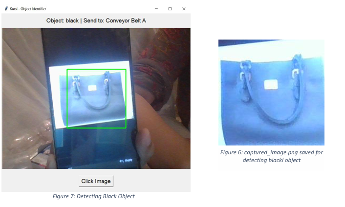
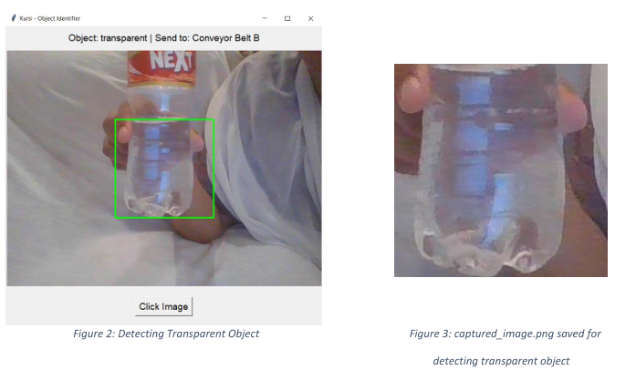
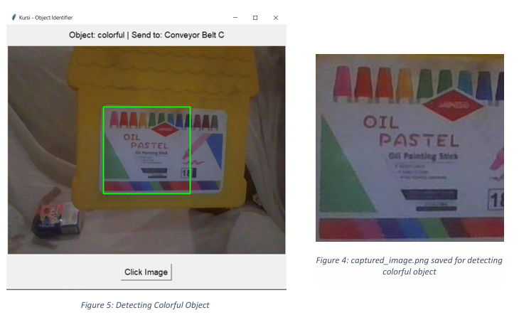

# Object Identifier Module for Plastic Recycling

## Project Overview

A Deep Learning-based object identification module developed using a Convolutional Neural Network (CNN) to classify plastic objects into three categories: **Black, Transparent, and Colorful**. The system aims to support automated plastic sorting and improve recycling efficiency.

## Model Performance

- **Model:** Convolutional Neural Network (CNN)
- **Accuracy:** 89%
- **Classification Categories:** Black, Transparent, Colorful

## Project Results

### 1. Black Plastic Identification

The model identifies and classifies black plastic objects.

### 2. Transparent Plastic Identification

The model identifies and classifies transparent plastic objects.

### 3. Colorful Plastic Identification

The model identifies and classifies colorful plastic objects.

## Technologies Used

- Python
- Deep Learning
- Convolutional Neural Networks (CNN)
- Image Classification

## Key Achievement

Achieved **89% classification accuracy** in identifying three categories of plastic objects for automated recycling applications.
